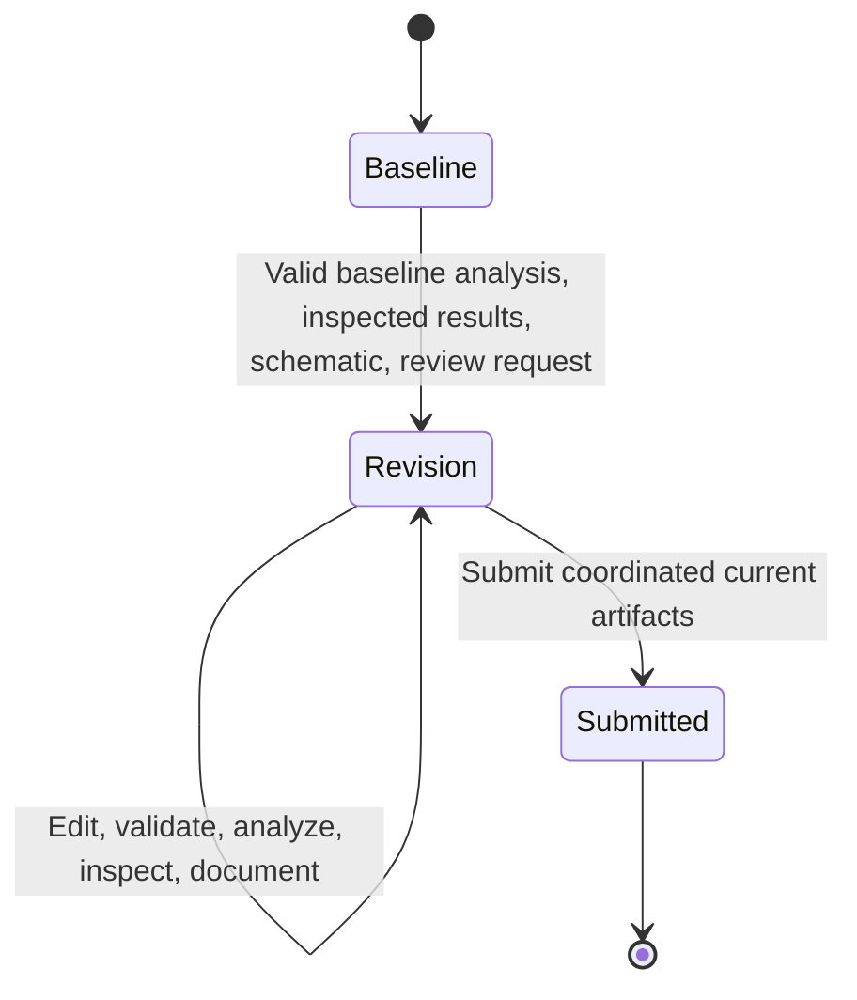

# Tool protocol and lifecycle

## Wire format

`python -m se_bench serve --workspace PATH` accepts newline-delimited requests
with exactly `tool` (string) and `arguments` (object). Responses have `ok` and
either `data` or `error`. Stdout contains only protocol JSON. OpenSees stdout and
stderr are captured in its subprocess. `tools.list` returns schemas without
consuming task budget. All task calls and malformed-request errors count toward
the budget. The development fixture allows 100 task calls and 30 seconds per
solver execution; no aggregate wall-clock or token budget is enforced yet.

This is a single-writer host. Run one server/process at a time for a workspace.
The `call` CLI can resume between turns, but concurrent calls to one workspace
are unsupported. A controller may coordinate agents and serialize their calls.

## State transitions

`model.put` always invalidates validation and active analysis/drawing/report,
including when reuploading an identical model. Superseded result files remain
for audit. Calling the solver again invalidates the active report and requires
fresh result inspection. Final submission is terminal. Start a new workspace for
a new attempt; there is no reset that silently erases failed calls.

## Tools

| Tool | Preconditions and effect |
| --- | --- |
| `task.read` | Returns initial brief, input model/schematic, criteria and constraints |
| `model.get` | Returns the current model and hash |
| `model.put` | Validates/replaces the full model and invalidates dependent state |
| `model.validate` | Validates model contract; does not prove stability |
| `solver.run` | Requires current validation; performs real OpenSees analysis |
| `results.get` | Inspects a specified current run and exposes warnings/results |
| `drawing.render` | Generates the current canonical SVG schematic |
| `review.request` | Requires baseline model/analysis/inspection/schematic; issues revision once |
| `report.write` | Requires inspected current results; records agent assessment without grading it |
| `submission.submit` | Requires current analysis/drawing/report after review; records final submission |

## Model contract

The adapter supports small 2D linear elastic frames in **N, m, Pa**. Node degrees
of freedom are `[ux, uy, rz]`; node coordinates are global `[x, y]`.
Nodal loads are `[Fx_N, Fy_N, Mz_Nm]`. An element's uniform load is a signed
transverse **local-y** intensity in N/m, where local x runs from its first node
to its second. Section fields are `A_m2`, `E_Pa`, and `I_m4` about the out-of-plane
axis. Restraint flags are 1=fixed, 0=free. Node/element ids are canonical positive
integer strings. The JSON Schema is emitted in `model.put` metadata; relational,
finite-value, and connectivity checks are enforced by `validate_model`.

The solver returns displacements `[ux_m, uy_m, rz_rad]`, support reactions
`[Fx_N, Fy_N, Mz_Nm]`, and 2D local element end forces
`[Ni_N, Vi_N, Mi_Nm, Nj_N, Vj_N, Mj_Nm]`. Positive local quantities follow the
element axes and OpenSees end-force convention; these are end resisting forces,
not a complete internal-force envelope.

No P-Delta, material nonlinearity, releases, dynamic response, load combinations,
design-code checks, or fabrication detailing are implemented. A future adapter
must explicitly declare supported operations and unsupported requests.

## Numerical oracle and tolerances

The development reference contains baseline and revised displacement, reaction,
and local end-force arrays from the pinned OpenSees version. The evaluator uses
relative tolerance 1e-7 and absolute tolerance 1e-8 in native output units for
these arrays. Global force/moment equilibrium uses separate absolute thresholds
of 0.01 N and 0.01 N.m. Reported roof displacement uses absolute tolerance 1e-9 m
and relative tolerance 1e-7. Reported residual uses absolute tolerance 1e-6 in
its respective component unit. Thresholds are fixture-specific.

The oracle is not independently expert-validated. Integration tests use
closed-form cantilever point-load/uniform-load displacements and equilibrium,
including a rotated member. Those checks validate important adapter conventions
but do not independently establish the entire portal reference.

## Reproducibility and isolation

Each run fingerprints task content, reference data, runner Python source, and
each model. Solver records identify the package, engine, and Python version.
Resuming under changed task/source content is rejected. Failed operations remain
in a hash-linked audit log. SVG and report content are checked against the
authoritative artifact records.

This is a local development harness. The public repository includes the oracle,
scripted reference client, evaluator, and future revision. Do **not** mount this
repository or `.evaluator` into an untrusted evaluated agent's filesystem. Hashes
are not authentication; a process with write access to both artifacts and state
can forge them. A study runner must place the tool host/evaluator in a separate
trusted service/container, expose only the agent tool API and permitted assets,
prevent oracle access, and enforce resource limits. These deployment controls
are not implemented yet.

Reports contain agent-authored explanations. Automatic success verifies the
structured assessment, not every natural-language claim. A blinded human rubric
must check interpretation, unsupported claims, and scope before research success
can be assigned.

## Solver implementation references

- [OpenSeesPy elasticBeamColumn](https://openseespydoc.readthedocs.io/en/latest/src/elasticBeamColumn.html)
- [OpenSeesPy eleLoad](https://openseespydoc.readthedocs.io/en/latest/src/eleload.html)

Every solve starts in a fresh process to avoid OpenSees global-state leakage.
The serial Linux adapter defaults `MPICH_INTERFACE_HOSTNAME=localhost` for wheels
that initialize MPI in containers with unresolved hostnames. An explicit
environment setting is preserved. No distributed MPI execution is used.
